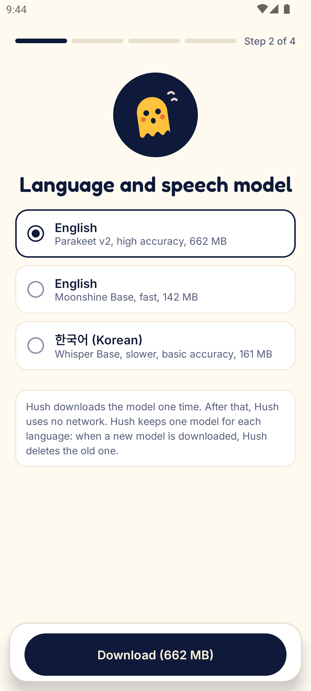
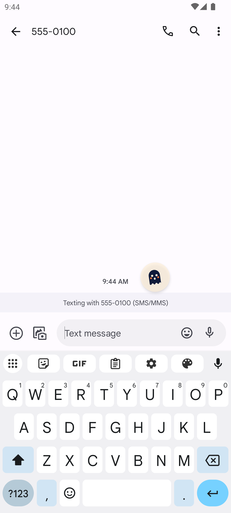
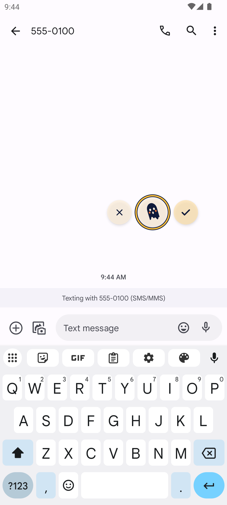
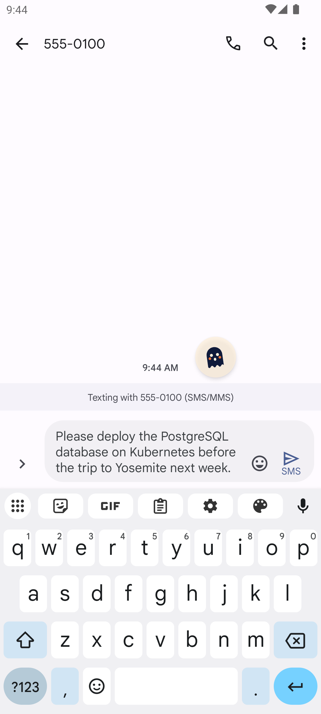
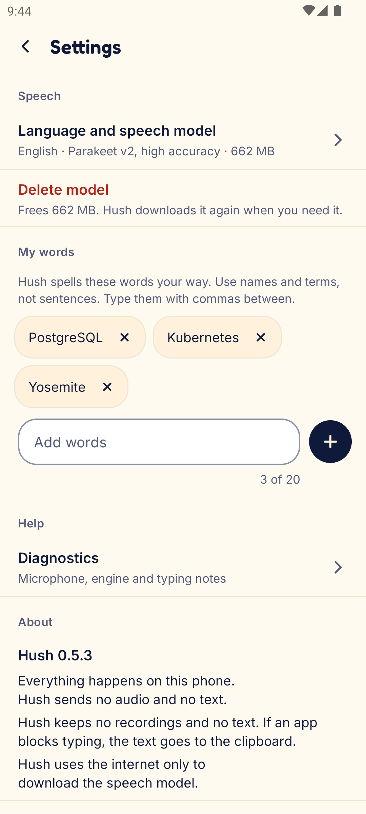

# Hush

Private voice typing for Android. Speak in any app, and Hush types it for you. Speech recognition runs on the phone.

<p>
  
  
  
  
  
</p>

## Features

- Works in any app. When a text field has focus, a small ghost button shows next to it.
- Tap the ghost and speak. Tap the check to put the text at the cursor, or X to cancel.
- Everything runs on the phone with [sherpa-onnx](https://github.com/k2-fsa/sherpa-onnx). No account, no server.
- My words: add names and terms, such as PostgreSQL or Kubernetes, and Hush spells them your way.
- English and Korean.

## Download

**[Download Hush.apk](https://github.com/ksuh90/hush/releases/latest/download/Hush.apk)** from the latest release. Hush needs Android 13 or later on an arm64 phone.

Open the APK to install it, then open Hush and follow the setup steps. If Android says the accessibility setting is restricted, go to Settings > Apps > Hush, tap ⋮ and choose "Allow restricted settings".

## Models

Hush downloads the model for your language one time.

| Language | Model | Size | License |
| --- | --- | --- | --- |
| English | NVIDIA Parakeet TDT 0.6B v2 | 662 MB | CC-BY-4.0 |
| English (faster) | Moonshine Base | 142 MB | MIT |
| Korean | Whisper Base | 161 MB | MIT |

My words works with Parakeet only.

## Privacy

Your audio and text never leave the phone. Hush uses the network only to download the model. It uses the accessibility service to find the focused text field and to type into it.

## Build

You need a JDK (17 or later) and the Android SDK.

```sh
./gradlew assembleRelease
```

The APK is in `app/build/outputs/apk/release/`.

## License

Hush is under the [MIT License](LICENSE). The speech models have the licenses listed above, and the Inter and Fredoka fonts are under the SIL Open Font License 1.1.
